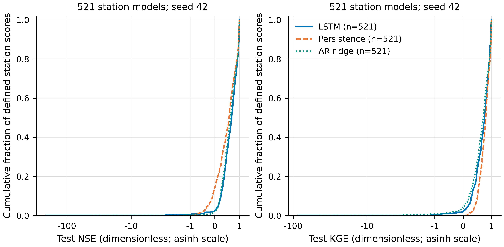
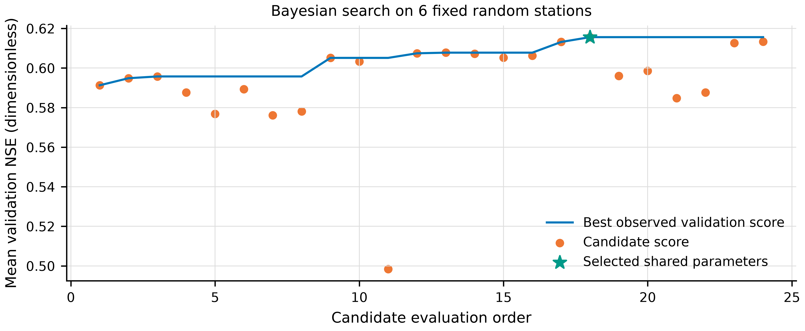
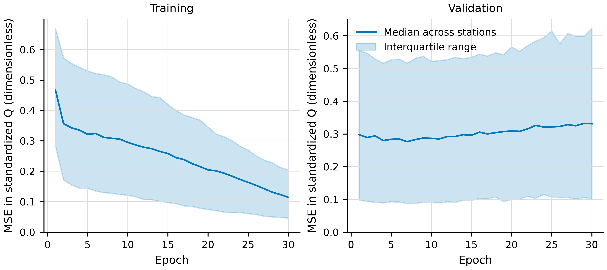

# 共享参数 LSTM 基线实验

已完成 521 个站点各一个独立模型，全部使用同一套超参数、单一种子 42 和 15 天输入窗口。各站点从头重新初始化训练，不复用贝叶斯搜索阶段模型。

贝叶斯优化评估了 24 套共享配置。固定调参站点由 521 个合格站点以采样种子 20261012 随机抽取：04224775, 05291000, 06278300, 07167500, 11381500, 12092000。目标为这 6 站点的平均验证 NSE，每个站点等权；测试集不参与任何选参。

最佳候选索引（从 0 开始）：17；平均验证 NSE：0.615620。参数：`{"hidden_size": 256, "num_layers": 2, "learning_rate": 0.002713975339231919, "weight_decay": 0.0001, "dropout": 0.0}`。这是给定搜索预算内的验证集最优结果，不能保证全局最优。

训练和选参总耗时 35.8 分钟。所有候选每站点训练 30 轮，按最低验证 MSE 保存轮次；最终模型亦训练 30 轮。数据顺序划分 70%/15%/15%，标准化仅拟合训练期；批量大小 128，AdamW、梯度裁剪 1，FP32 和确定性算法。LSTM 的架构、学习率、层间 dropout、weight decay 参与搜索，数据协议与 STEH 一致。

| 模型 | NSE 均值 ± SD | NSE 中位数 | KGE 均值 ± SD | KGE 中位数 | 站点数 |
|---|---:|---:|---:|---:|---:|
| LSTM | 0.190 ± 9.272 | 0.643 | 0.486 ± 3.786 | 0.717 | 521 |
| Persistence | 0.468 ± 0.399 | 0.528 | 0.734 ± 0.199 | 0.764 | 521 |
| AR ridge | 0.501 ± 1.856 | 0.595 | 0.514 ± 2.010 | 0.669 | 521 |

LSTM 在 464/521 个站点的 NSE 高于持续性基线，在 380/521 个站点高于 AR；负 NSE 站点 13 个，全部保留。SD 是站点间散布，不是多种子误差或置信区间。

全部指标已从原始逐日 CSV 独立重算，并核对候选的完整调参站点面板、共享参数、种子和预测日期。RMSE、MAE、bias 单位为 cfs（ft³/s），bias 为预测减观测。

Empirical distributions of test NSE and KGE across all 521 stations. Each station contributes one freshly trained, seed-42 LSTM with the same globally selected parameters. Q-history references use identical target dates. All negative results are included. An asinh horizontal scale preserves extreme negative tails.

24 global configurations evaluated by the unweighted mean validation NSE on the same 6 randomly sampled stations. The first four candidates reproduce the initial grid; subsequent candidates use the seeded TPE sampler. The selected star marks the best observed validation configuration.

Final fresh-model learning curves for 521 stations sharing one configuration and seed 42. Lines show the median and shading the interquartile range across stations. Q scaling uses each station's training period only.

提供的 CSV 可能包含此前填补值，未提供逐日原始观测标志，不能称为仅原始观测评估。基线 AR 和持续性仅使用 Q 历史，LSTM 还使用气象强迫。一个种子不估计初始化敏感性；当前不作显著性或全总体优越性结论。

原始数据位于仓库 data/Forcing 和 data/Streamflow；raw/ 保存全部候选的验证预测、训练曲线、模型配置和最终逐日预测。最终模型检查点单独归档；SHA256 和来源索引随结果保存。

复现：`python experiments/global_lstm.py --scope all --workers 14`；绘图：`python experiments/report_global_lstm.py --input experiments/lstm_global_20261012/raw --output experiments/lstm_global_20261012/report --reference experiments/lstm_global_20261012/reference_manifest.json`。

按照 [academic-research-skills visualization_agent](https://github.com/Imbad0202/academic-research-skills/blob/main/academic-paper/agents/visualization_agent.md) 生成色盲友好配色、600 dpi PNG 与矢量 PDF/SVG，并记录图表六项来源追踪；skill 版本 d1e51716e53fc371727ea6164dd709fc8ea28c97。

TPE 搜索参考 [Optuna 4.9.0 官方文档](https://optuna.readthedocs.io/en/v4.9.0/reference/samplers/generated/optuna.samplers.TPESampler.html)。

当目标方差或相关性无法定义时，NSE/KGE 按未定义保留为空值；汇总均值和 CDF 仅使用对应指标有定义的站点，model_summary.csv 记录其数量。不将未定义值替换成 0，也不删除对应站点记录。